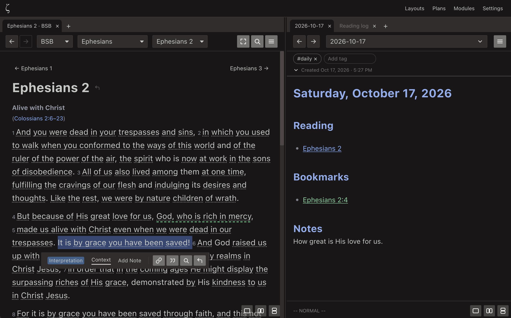

# Zoe

Bible study that let's you focus on God's word without distractions, while still having the power you need to dive deep.

## What you can do

<!-- TODO: trim, reorder, and reword. These are the things the app does today. -->

- **Read** the Bible with a calm, distraction-free reader mode, or every reference, footnote, and definition in one place.
- **Mark** the text with highlights and underlines (even partial verses), and keep a note with any highlight.
- **Write** notes, prayers, and journal entries as ordinary documents. Link to Bible text with wikilinks `[[@John 3:16]]`.
- **Look up** words: tap a word to see its Strong's entry, and search the text, and your own notes together.
- **Follow a plan** such as M'Cheyne's or Bible in a year, and keep a reading log that fills itself in.
- **Work in your own layout:** panes and tabs, side by side, saved as layouts.

## Your notes are yours

Everything you write is saved as plain Markdown files in a folder on your computer (you choose where in Settings). There is no account and nothing is uploaded. You can open the notes in any editor, back them up with any tool, or copy the folder to a new computer. If you stop using Zoe, your notes still make sense.

## Getting Zoe

**NOTICE:** Zoe is in open alpha. Feel free to report issues in [GitHub](https://github.com/sialis-software/zoe/issues).

Download the installer for your computer from the [Releases](https://github.com/sialis-software/zoe/releases) page:

| Computer | File |
|---|---|
| Mac | the `.dmg`: open it and drag Zoe to Applications |
| Windows | the `-setup.exe` installer |
| Linux | the `.deb` (Debian, Ubuntu), or the AppImage |

### If your computer warns about Zoe

The installers are not code-signed yet. Signing is how Apple and Microsoft recognize who made an app, and it needs paid developer accounts that Zoe does not have yet. Until then, your computer may warn you the first time you open Zoe. The warning is about the missing signature, not about anything it found in the app. Here is how to continue:

- **Mac:** if Zoe "can't be opened" or "is damaged", open **System Settings**, then **Privacy & Security**, scroll down to **Security**, and choose **Open Anyway** next to the message about Zoe. (Try opening Zoe first, so the message appears.) If that does not work, run `xattr -dr com.apple.quarantine /Applications/Zoe.app` in Terminal.
- **Windows:** when "Windows protected your PC" appears, choose **More info**, then **Run anyway**.

Zoe comes with the Berean Standard Bible and Strong's dictionaries, so you can start reading straight away. More Bibles, commentaries, and dictionaries can be downloaded from within Zoe (they come from the [CrossWire](https://crosswire.org) library; check each one's license). **Modern copyrighted translations that need a purchased unlock key (such as the NASB or NIV) are not supported yet.**

Not every Bible shows perfectly yet. Modules mark up their text in many different ways, and reading all of them correctly is the biggest gap in Zoe. If a translation looks wrong, please [report it](https://github.com/sialis-software/zoe/issues) with the module name and the passage (see [the SWORD notes](docs/01-sword-integration.md) for what helps).

## How Zoe is made

Much of Zoe's code, tests, documentation, sample content, and interface icons was written with AI assistants, working under the direction of the maintainer. Bug reports are welcome, but they are expected to be reviewed and written by a person: please do not file unreviewed reports from an AI tool.

## License

Zoe is free software. You may use it under either the [MIT license](LICENSE-MIT) or the [Apache License 2.0](LICENSE-APACHE), as you choose. Copyright (c) 2026 Sialis LLC.

The Bible text and dictionaries that come with the app, and the libraries it is built from, have their own licenses: see [NOTICES.md](NOTICES.md) and [THIRD-PARTY-LICENSES.txt](THIRD-PARTY-LICENSES.txt).
